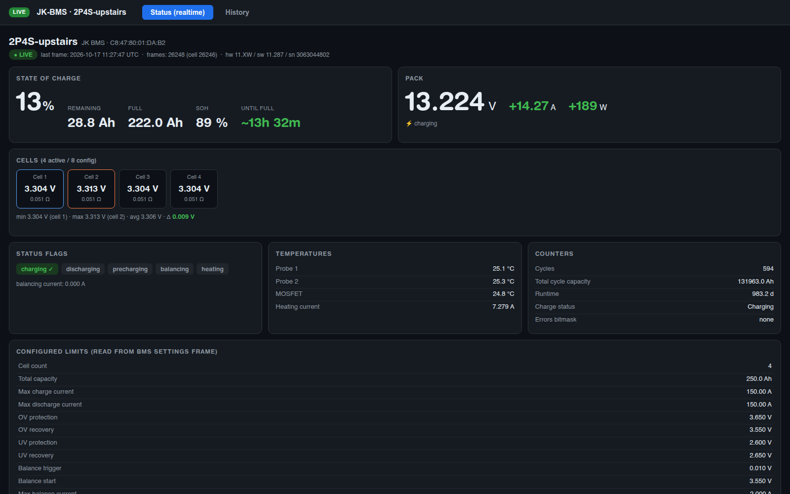
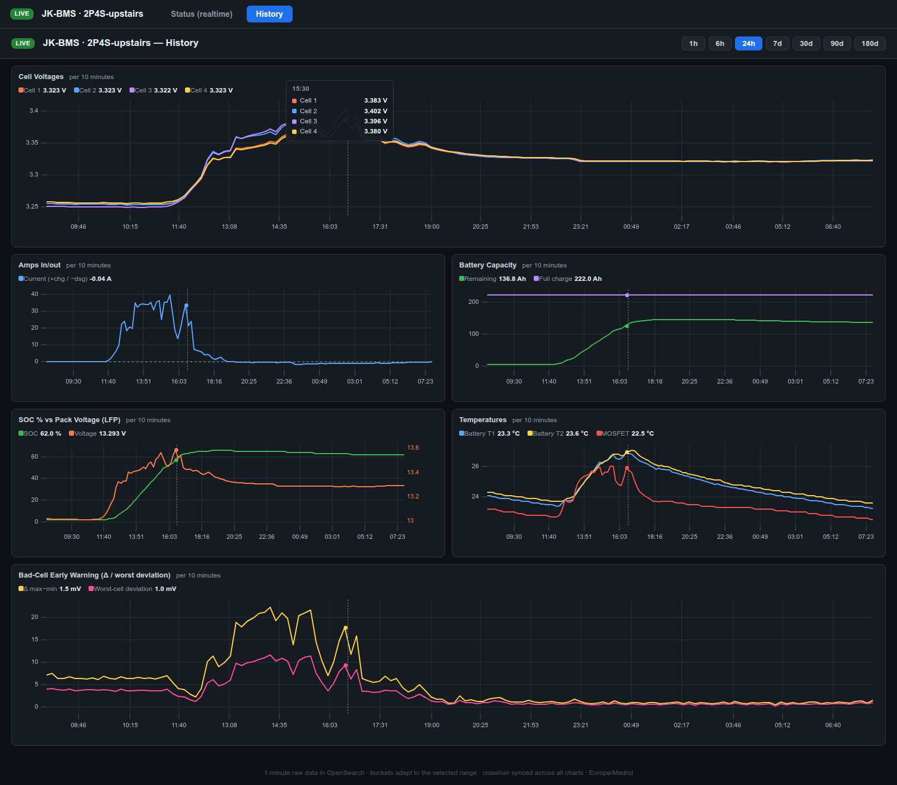

# jk-bms-opensearch-dashboard


**Read-only Bluetooth monitoring for JK BMS battery monitors** — a lean stack
that streams your battery into [OpenSearch](https://opensearch.org/) and serves
a self-contained web UI: live status page + history charts with a crosshair
synchronized across every chart.

Designed to stay *slim*: **OpenSearch is the only infrastructure component** —
no Kibana/OpenSearch-Dashboards, no JVM sidecars, no external chart CDN.
Everything else is two small Python services (standard library + [bleak](https://github.com/hbldh/bleak))
and a vendored copy of [uPlot](https://github.com/leeoniya/uPlot).

```
┌────────────┐  BLE (read-only)  ┌──────────────┐    HTTP     ┌───────────────┐
│  JK BMS    │ ────────────────► │  collector   │ ──────────► │  OpenSearch   │
│ (battery)  │   ~1 Hz frames    │  (backend)   │  1 doc/min  │  (time-series)│
└────────────┘                   └──────┬───────┘             └──────┬────────┘
                                        │ /api/state                 │ query
                                        ▼                            ▼
                                 ┌─────────────────────────────────────────┐
                                 │   web frontend  (:8098)                 │
                                 │   tab 1: live status page               │
                                 │   tab 2: history charts (uPlot)         │
                                 └─────────────────────────────────────────┘
```

## Features

- **Strictly read-only BLE client** — only ever *requests* cell-info and
  device-info frames; no settings write exists in this code base.
- **Live status page**: SOC + SOH, remaining/full Ah, direction-aware time
  prediction ("until empty" / "until full"), signed power (V×I), per-cell
  voltage & balance resistance, temperatures, status flags, counters, and all
  configured limits read from the BMS settings frame.
- **History charts**: adaptive buckets (~180 per selected range, labeled
  "per N minutes/hours/days"), y-axes auto-zoomed to the data range,
  **crosshair synchronized across all charts** with a tooltip listing every
  series value at cursor height, range buttons 1h → 180d, auto-refresh.
- **Derived health metrics** indexed per minute: cell Δ (max−min in mV),
  worst-cell deviation, C-rate, estimated runtime — the "bad-cell early
  warning" signals.
- **Graceful BLE lifecycle**: SIGTERM closes the LE link cleanly (a
  killed-while-connected client can lock out the phone app).
- Daily indices (`jkbms-YYYY.MM.DD`), stale snapshots flagged so gaps stay
  visible instead of silently disappearing.

## Screenshots

| Live status | History with synchronized crosshair |
|---|---|
|  |  |

## Live demo

**https://bms.cue4net.com/** — a real production instance of this exact stack
(same code, same containers). Like everything here it is strictly read-only:
you can browse the live status and the full history; nothing can be changed.

## Tested hardware

Verified and running daily on the deployment server (an always-on desktop
tower — mainboard MSI MS-7885):

- **BMS:** JK-BMS **`JK_B2A8S20P`** — 8-slot board, 4s pack configured
  (hw `11.XW` / fw `11.287`). The protocol layer targets the common JK frame
  format shared across the JK-B2A/B1A family, so other variants should work.
- **Bluetooth:** plain BlueZ (`hci0`) against a USB Bluetooth radio
  (Realtek RTL8771, `btusb`) in a chassis USB port of that server — direct
  adapter access, no ESP32/BLE-proxy chains.
- **Host:** Ubuntu 25.04, Docker Compose v2.37, distro BlueZ.
- **Uptime:** continuous ~1 Hz polling, read-only, multi-day runs across
  collector restarts and one full production migration.

Running a different model or adapter (USB dongles, ESP32 BLE proxies, other
hosts)? PRs with test reports are very welcome.

## Quickstart (Docker Compose)

```bash
git clone https://github.com/cue108/jk-bms-opensearch-dashboard.git && cd jk-bms-opensearch-dashboard
cp .env.example .env
# edit .env: set JK_BMS_MAC (your BMS Bluetooth MAC), DEVICE_NAME, timezones
docker compose up -d
```

Then open **http://localhost:8098** — tab 1 is the live status, tab 2 the
history charts. First data lands in OpenSearch after ~1 minute.

Find your BMS MAC with `bluetoothctl scan on` (or the JK app / any BLE scanner).

### Requirements

- Linux host with BlueZ running (`systemctl status bluetooth`) and a BLE
  adapter within range of the BMS
- Docker + Docker Compose v2
- **Bluetooth inside Docker works out of the box** — the collector mounts the
  host's D-Bus socket and carries the one `security_opt` line Ubuntu needs
  (its AppArmor docker-default profile blocks D-Bus); no `privileged`, no host
  networking. Full explanation + troubleshooting: **[docs/bluetooth.md](docs/bluetooth.md)**
- The JK BMS allows **one central at a time**: while the collector is connected
  the phone app cannot connect (and vice versa)

## Configuration

All configuration lives in `.env` (see [.env.example](.env.example)):

| Variable | Default | Meaning |
|---|---|---|
| `JK_BMS_MAC` | *(required)* | Bluetooth MAC of the BMS |
| `DEVICE_NAME` | `JK BMS` | name in the web UI |
| `INDEX_PREFIX` | `jkbms` | daily index = `PREFIX-YYYY.MM.DD` |
| `INDEX_TZ` | `UTC` | timezone used for the daily index date |
| `CHARTS_TZ` | `UTC` | timezone shown on chart axes |
| `OS_PORT` | `9200` | OpenSearch host port |
| `BACKEND_PORT` | `8099` | collector state API host port |
| `WEB_PORT` | `8098` | web UI host port |

## The data model (per-minute document)

```
@timestamp, stale, streaming, status
device.{address,name,model,hardware,software,serial}
cells.{count_active,count_config,v1…v8,min_cell,max_cell,
       min_voltage,max_voltage,avg_voltage,delta_voltage,
       delta_mv,worst_cell,worst_deviation_mv,…}
pack.{voltage,current,power,charge_rate_c}
soc.{soc,soh,remaining_ah,full_ah,cycles,runtime_seconds,eta_empty_h,eta_full_h,…}
temps.{t1,t2,mosfet,heating,heating_current}
status.{charging,discharging,balancing,errors_mask,…}
```

Balance-wire resistances are deliberately **not** indexed (they never change —
live view only). Stale snapshots are indexed with `stale: true`.

## Web UI details

- **Tab "Status"** polls the collector's `/api/state` (proxied same-origin,
  2 s cadence).
- **Tab "History"** queries OpenSearch directly (`date_histogram`, bucket
  count derived from the selected range so resolution adapts from
  "per 1 minute" at 1h to "per 1 day" at 180d).
- The crosshair uses uPlot's native `cursor.sync` — hovering one chart moves
  the same cursor line through **all** charts for time-aligned comparison.
- Static assets are vendored (`frontend/web/`) — the UI works air-gapped.

## Alternative: native install (no Docker)

Python-only path for machines where a container is unwanted (example unit in
[backend/systemd/jk-bms@.service](backend/systemd/jk-bms@.service)):

```bash
sudo apt install bluez            # if not present
pip install -r backend/requirements.txt
export JK_BMS_MAC=… OPENSEARCH_URL=http://127.0.0.1:9200
python backend/collector.py       # state API on :8099 + per-minute indexing
python frontend/server.py         # web UI on :8098
```

The collector needs D-Bus access to `bluetoothd` (member of group
`bluetooth`, or run via systemd as shown). `opensearch-config/setup.sh`
installs the index template.

## Security notes (read before exposing anything)

- Defaults are tuned for a **trusted home LAN**: OpenSearch runs with its
  security plugin disabled on port 9200. That is fine on a LAN — and
  never acceptable on the internet.
- The web frontend serves fixed routes with path containment (attempts like
  `/web/../file` resolve and are rejected), but it has **no authentication**:
  whoever can reach it sees your battery/energy usage patterns.
- Before any public exposure: put a reverse proxy with TLS + auth in front
  (Caddy/nginx/Traefik), keep OpenSearch LAN-only, and consider VPN.

Fuller discussion: **[docs/security.md](docs/security.md)**.

## Troubleshooting

| Symptom | Likely cause |
|---|---|
| `waiting (BMS not advertising…)` | phone app holds the single BLE link — close it |
| `JK_BMS_MAC is not set` | `.env` missing/placeholder not edited |
| collector exits: D-Bus errors | BlueZ not running on host, or socket not at `/run/dbus/system_bus_socket` (see docs/bluetooth.md) |
| no documents after ~2 min | `docker compose logs collector` — check OpenSearch health |
| health shows `no-stream` | connected but idle/frames stopped — watch logs for re-request warnings |

```bash
docker compose logs -f collector
curl -s localhost:8099/api/state | jq .live
curl -s "localhost:9200/jkbms-*/_search?size=1&sort=@timestamp:desc" | jq .
```

## Credits

- Protocol knowledge based on the excellent reverse-engineering work in
  [syssi/esphome-jk-bms](https://github.com/syssi/esphome-jk-bms).
- Charts by [uPlot](https://github.com/leeoniya/uPlot) (MIT), vendored.
- Data store: [OpenSearch](https://opensearch.org/) (Apache-2.0).

## License

[MIT](LICENSE) — free to use, modify, and redistribute.

---

*If this project helps you keep an eye on your battery — consider giving it a
**⭐️**. It is the cheapest way to help others find it.*
