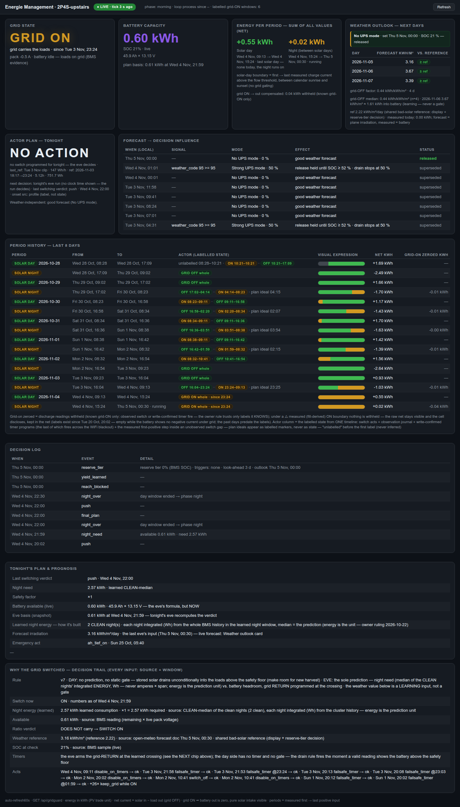

# GridGuard — continuous intelligent, learning and weather-aware prediction and grid guard

**GridGuard is an EXAMPLE addon**: a deliberately specific solution to one
particular setup, kept in this repository as a worked example of the addon
integration contract (root README → "Addons — the integration offer") and for
what it actually does. The setup it targets:

- **Solar charging a large LiFePO4 battery** that feeds **an inverter with
  UPS behaviour** — when the AC input drops, the inverter carries the loads
  from the battery.
- **Extended grid-off periods** (AC input deliberately OFF) to maximize
  self-consumed solar energy.
- **UPS preparation for bad-weather forecasts** — in a south-Spain
  installation where grid outages most probably happen during bad weather,
  the battery is held ready exactly when the forecast promises trouble.
- **The house switches its wireless off at night** (sleep comfort), which
  makes the smart relay unreachable exactly when an intervention might be
  needed — GridGuard therefore arms **pre-programmed ON timers on the
  device** before the WiFi-off window starts.

The physical setup:

```
    sunlight                                  mains / grid
        │                                           │
        │                                           │ AC
        ▼                                           ▼
  ┌───────────┐                             ┌────────────────┐
  │  Solar    │                             │  Smart relay   │◀····· GridGuard
  │  panels   │                             │ ("Main" actor) │       (arms ON timers before the WiFi-off window)
  └─────┬─────┘                             └───────┬────────┘
        │ DC charging                               │ switched AC input
        ▼                                           ▼
  ┌───────────┐                             ┌────────────────┐
  │  LiFePO4  │──── DC ───────────────────▶ │    Inverter    │────── AC ──────▶ Loads
  │  battery  │                             │   (UPS mode)   │                 (house)
  └───────────┘                             └────────────────┘
```

Your own installation will differ in the details: the scenario above is just
an example, and everything environment-specific — windows, thresholds, the
weather reference — is configuration (table below).

GridGuard keeps battery-backed loads fed through the night. A smart relay
("Main", eWeLink/CoolKit) feeds grid power to the loads behind a 12 V LiFePO4
pack that the base stack historizes per minute; without grid power the
battery carries them. The relay is reachable over WLAN (LAN *and* cloud), and
that link can disappear for the night — while it is gone **no intervention
is possible**, so anything that must happen overnight has to be armed
beforehand as a device-local timer. When GridGuard itself may act is
configuration: `WINDOW_START` (default **09:00**) and `WINDOW_END`
(default **22:00**).
GridGuard turns that constraint into a small routine: in the evening it runs
the **one ratio check** — available pack energy (`remaining_ah` × the
recent-AVERAGE pack voltage; the BMS counter is the trusted mid-range
instrument, cell voltage only speaks at the knee/deep band) versus
`SAFETY_FACTOR` × the learned night need (median Wh of the CLEAN night
buckets) — and either releases the grid for the night
(plus a verified, computed failsafe grid-on timer inside the learned night, or
none when the floor crossing lies beyond the horizon) or keeps/brings the grid
on. In the morning — after the WLAN returns — it removes grid power
again, but only once the measured evidence is there: remaining capacity over
`AH_OFF` with real solar current (`≥ SOLAR_OFF_A`, held for `SOLAR_HOLD_S`):
the morning decision is measured at the battery, never forecast. A covered morning simply keeps the grid on until
the sun actually shows up; nothing forces an early off. The addon shares
nothing with the base stack except read access to the same OpenSearch index.

It decides continuously: the loop runs around the clock and evaluates one
decision per tick — by default every 300 s while the window is active
(`POLL_FAST_S`), every 600 s in the morning phase (`POLL_MORNING_S`) and
every 1800 s at night (`PROBE_NIGHT_S`), on the order of ~150 decisions per
day. Each tick walks the configured gates (deep floor, capacity + solar
evidence, the evening ratio, the weather reserve tiers, the forecast gate,
the WLAN reach gate), every switch is read-back-verified over both channels
(eWeLink cloud and LAN) before it counts, and every decision is journaled
twice (JSONL + events index). The weather outlook is re-evaluated every
`FORECAST_REFRESH_MIN` (default 30 min), and the learning side reads the
per-minute BMS history over the rolling `HIST_DAYS` window (default 7 days)
plus the reference nights (`REF_NIGHTS`).

The live production instance carries this addon's own panel:
**https://bms.cue4net.com/#gridguard**

## Screenshots

| GridGuard monitor panel |
|---|
|  |

## Architecture

```
jk-bms-opensearch-dashboard/
└── addons/gridguard/                    ← opt-in, own compose file
    ├── docker-compose.gridguard.yml     (network_mode: host)
    ├── Dockerfile                       (python:3.12-alpine, stdlib-only)
    ├── .env.example
    ├── README.md                        (EN)
    └── gridguard/
        ├── config.py         ← env contract: every knob and its default
        ├── main.py           ← window loop / state machine (the single clock)
        ├── verdict.py        ← pure decision logic (tiers, gates), no I/O
        ├── planner.py        ← evening & night plan, the one ratio check
        ├── learn.py          ← rolling night-need learning (CLEAN buckets)
        ├── reference.py      ← reference-load model
        ├── periods.py        ← solar-day boundaries, day-hold phases
        ├── solar_predict.py  ← morning onset prediction from consecutive sunny days
        ├── bms.py            ← OpenSearch reads (cells, charge current, trend)
        ├── weather.py        ← open-meteo: radiation, storm outlook, forecast docs
        ├── switchlink.py     ← eWeLink cloud API primary, LAN :8081 fallback
        ├── messages.py       ← push texts (en + de locale)
        ├── notify.py         ← NTFY_WEBHOOK (generic)
        ├── audit.py          ← JSONL journal + events-index dual-write
        ├── reach.py          ← WLAN reachability probe (the write gate)
        ├── web_page.py       ← the monitor page (HTML/JS)
        ├── web_payload.py    ← the page's payload assembly
        └── webservice.py     ← small stdlib HTTP service (default :8101)
```

In English: `main.py` owns the single clock and the window state machine
(startup → morning → day hold → evening plan → final → night), `verdict.py`
holds the pure decision logic, `planner.py`/`learn.py` build the night plan
from the learned need, `bms.py`/`weather.py`/`reference.py` read the inputs,
`switchlink.py` cascades eWeLink cloud → LAN :8081, `reach.py` gates every
write on WLAN presence, `audit.py` journals and dual-writes, and
`web_page.py`/`web_payload.py`/`webservice.py` serve the monitor page on
`:8101`. Running with `network_mode: host` is what lets one container reach
OpenSearch, the cloud and the switch's LAN side at once.

## Quick start

From the repository root:

```bash
cd addons/gridguard
cp .env.example .env
chmod 600 .env                # cloud credentials + device key live in here
# edit .env: fill in the eWeLink account (EWCLOUD_*), the Main switch
# (SW_MAIN_DEVICEID / SW_MAIN_DEVICEKEY / SW_MAIN_IP), the ntfy webhook and
# your OpenSearch URL (table below) — keep DRY_RUN=1 for now
docker compose -f docker-compose.gridguard.yml up -d
```

The journal (JSONL, no secrets) lands in `./data`; follow the first evening
with `docker compose -f docker-compose.gridguard.yml logs -f`.

## Standalone deployment & registration (worked example)

This addon is a **self-sufficient container**: one image runs the decision
worker *and* a small stdlib web service. It reads `bms-*` and writes its own
`gridguard-events-*` / `gridguard-weather-*` directly against the OpenSearch
cluster — it never needs core for data, and nothing here talks to the BMS
hardware (that is core's collector).

**Endpoints** (default port 8101, `WEB_PORT` overrides; with
`network_mode: host` the port binds on the host directly):

- `GET /` — the Energie Management page (works standalone in any browser)
- `GET /api/gridguard` — live payload JSON
- `GET /health` — `{id:"gridguard", title:"Energie Management", order:20,
  version, contract_version:1, fresh, age_s, newest_ts, hashes:["grid"]}`

**Run anywhere on the LAN that reaches the cluster:** set `OPENSEARCH_URL`,
`BMS_INDEX`, `TZ` (plus the existing actor env), then
`docker compose -f docker-compose.gridguard.yml up -d --build`.

**Register in core (optional):** add `gridguard = http://<host>:8101/` to core's
`frontend/addons.conf`. Within ≤15 s core's portal shows the tab while
`/health` reports fresh; remove the line and the tab disappears. Everything on
this page works without core.

**Data contract for consumers:** every document carries `ts` as ISO-8601 with
an explicit offset — the decision-event docs are UTC, same semantics as `bms-*`
`@timestamp` — join freely.

## Configuration

All configuration lives in `.env` (see [.env.example](.env.example)) — the
file below is the complete contract, defaults verbatim:

| Variable | Default | Meaning |
|---|---|---|
| `TZ` | *(required)* | timezone for all windows and timers — set to YOUR timezone (the example ships `Europe/Madrid`) |
| `WINDOW_START` | `09:00` | morning window opens: grid-release verdict starts (a WLAN return detected before `WINDOW_START` opens the window early) |
| `WINDOW_END` | `22:00` | last intervention; until `WINDOW_START` the system is in NIGHT, inactive by design |
| `EVE_START` | `20:00` | evening planning phase starts (safe/watch verdicts + timer management) |
| `FINAL_OFFSET_MIN` | `5` | FINAL phase = `WINDOW_END` minus this many minutes: last read, plan frozen, end of interventions |
| `WLAN_IFACE` | *(empty)* | host WLAN interface probed each tick: `operstate=up` = reachable — the gate for every write and every grid-off decision; empty = auto-discover the single interface |
| `THRESH_DEEP` | `2.90` | deep-floor safety limit (V): any cell ≤ this → grid on immediately (every awake phase, incl. midday) |
| `TRUE_FLOOR_V` | `3.15` | true (uncorrected) cell-voltage floor (V) — the deep-band measurement baseline |
| `R_CELL_OHM` | `0.005` | per-cell DC path resistance (Ω), live-derived — feeds the cell-voltage correction |
| `AH_OFF` | `10` | minimum remaining capacity (Ah) before the morning grid-off is allowed (it also needs real solar current, see `SOLAR_OFF_A`) |
| `SOLAR_OFF_A` | `10` | solar current (A) required for the morning grid-off: the grid switches off only when the pack has charged at ≥ this |
| `SOLAR_HOLD_S` | `300` | hold duration (s): `SOLAR_OFF_A` must hold that long before the grid may switch off |
| `SOLAR_NOISE_A` | `2.0` | solar noise band (A): pack current below this counts as "no sun" for the low-capacity checks |
| `SAFETY_FACTOR` | `1.0` | evening ratio margin: grid releases for the night only when the available pack energy ≥ this × the learned night need — `1.0` = the raw learned need; the shipped example carries the calibrated value `1.2` (see CALIBRATION.md) |
| `HIST_DAYS` | `7` | rolling learning window (days): night load + array sun-run are learned from the BMS history; night buckets are fetched over the same window |
| `BMS_CELL_FIELDS` | `v1,v2,v3,v4,v5,v6,v7,v8` | cell-voltage fields read from each BMS document |
| `BMS_CURRENT_PATH` | `pack.current` | document path of the pack current (its sign is the charge/discharge direction) |
| `BMS_REMAINING_AH_PATH` | `soc.remaining_ah` | document path of the remaining capacity (Ah) |
| `OPENSEARCH_URL` | *(required)* | BMS index source (host networking → the base stack's OpenSearch; point at your own; the example ships `http://127.0.0.1:9205`) |
| `BMS_INDEX` | *(required)* | index pattern of the per-minute BMS history (the example ships `bms-2p4s-upstairs-*`) |
| `EWCLOUD_EMAIL` | *(required, ships empty)* | eWeLink cloud account e-mail (secret) |
| `EWCLOUD_PASS` | *(required, ships empty)* | eWeLink cloud account password (secret) |
| `EWCLOUD_CC` | `+34` | phone country code used for the cloud login |
| `SW_MAIN_DEVICEID` | *(required, ships empty)* | eWeLink device id of the "Main" grid switch |
| `SW_MAIN_DEVICEKEY` | *(required, ships empty)* | device key for LAN encryption + cloud writes (secret) |
| `SW_MAIN_IP` | *(required, ships empty)* | LAN address of the switch (fallback channel) |
| `NTFY_WEBHOOK` | *(required, ships empty)* | ntfy topic webhook URL for pushes |
| `MSG_LANG` | `en` | push message language |
| `WEATHER_LAT` | *(empty)* | open-Meteo latitude; empty (with `WEATHER_LON`) = weather module off |
| `WEATHER_LON` | *(empty)* | open-Meteo longitude; empty (with `WEATHER_LAT`) = weather module off |
| `WEATHER_MIN_J` | *(empty)* | morning-radiation floor (J/m²) with **two roles**: (1) **release-GATE** — today's forecast sum below this floor → `forecast_ok = False` → BOTH releases are prevented (grid stays on, audited as `grid_off_suppressed_weather`); it may only PREVENT a release, never force one. Unset floor or any missing/failed forecast = conservative hold. (2) **reserve tier-1 reference** — the SAME number the weather card displays: `≥ TIER1_DAYS` consecutive outlook days below it → the 30 % tier (trigger sentence and card can never contradict). Example: `8000000` = 8 MJ/m² (preliminary bootstrap value, recalibrate) |
| `WEATHER_INDEX` | `1` | forecast dual-write: `0` disables the morning-forecast ship into the weather history index (kill-switch → jsonl-only; ship errors are throttled to one stderr line per hour and never disturb the loop) |
| `WEATHER_INDEX_PREFIX` | `gridguard-weather` | weather-history index prefix: `ship_forecast` POSTs one md5-idempotent doc per local day + radiation value into `{prefix}-{YYYY.MM.DD}` (`radiation_sum_j: null` = failed forecast day, shipped as well) |
| `POLL_FAST_S` | `300` | fast poll interval (s): emergency check + evening phase |
| `POLL_MORNING_S` | `600` | morning poll interval (s) |
| `PROBE_NIGHT_S` | `1800` | night probe interval (s): detects a WLAN return before `WINDOW_START` |
| `LOG_DIR` | `/data` | JSONL journal directory (bind-mounted volume) |
| `DRY_RUN` | `0` | `1` = full logic incl. all pushes, **zero** writes/timers (the shipped example keeps `1` for the first evenings) |
| `EVENTS_INDEX_PREFIX` | `gridguard-events` | Decision-Index: every JSONL audit line is additionally dual-written to `{OPENSEARCH_URL}/{prefix}-{YYYY.MM.DD}/_doc` (local date of the record) |
| `EVENTS_INDEX` | `1` | `0` disables the Decision-Index dual-write → jsonl-only (kill-switch; index errors are throttled to one stderr line per hour and never disturb the loop) |
| `FLOW_A` | `3.0` | solar-day flow factor of the day-boundary model (`periods.py`) — mirror of `GG_FLOW_A` in `web_payload.py`, change both together |
| `FORECAST_REFRESH_MIN` | `30` | forecast/outlook revision cadence (min): the midday re-ship that also re-evaluates the reserve tier |
| `REF_NIGHTS` | `5` | reference-load model: newest-first real nights aggregated into the reference load |
| `REF_MIN_CLIP_MIN` | `30` | reference-load model: minimum night-clip length (min) — shorter fragments don't count |
| `TIER1_DAYS` | `2` | reserve tier-1 (30 %): consecutive outlook days whose radiation sits below `WEATHER_MIN_J` |
| `TIER2_WMO_CODE` | `95` | reserve tier-2 (50 %): outlook day with `weather_code` ≥ this (WMO thunderstorm class) |
| `TIER2_GUST_KMH` | `75` | reserve tier-2 (50 %): day gust maximum STRICTLY above this (km/h) |
| `TIER2_INTENSITY_MMH` | `25` | reserve tier-2 (50 %): day's peak HOURLY rain rate at/above this (mm/h) — extreme weather, not the threat of a puddle (DWD-anchored) |
| `TIER_LOOKAHEAD_DAYS` | `3` | outlook days considered by the tier evaluation |
| `TIER_RELEASE_HYST_PCT` | `2` | while a tier is held: a discharge-release needs SOC ≥ tier + this (%) |

Secrets (`EWCLOUD_*`, `SW_MAIN_DEVICEKEY`, the webhook) exist only in `.env`
(`chmod 600`); they never appear in logs, pushes or the JSONL journal.

## Calibration — measure before arming

Gates are measured, not guessed. [CALIBRATION.md](CALIBRATION.md) records the
current status and [tools/calibrate.py](tools/calibrate.py) derives the
numbers from real BMS history in your index.

- **Rule: measure before arming.** The gate set below ships as engineering
  defaults; re-measure them before the first `DRY_RUN=0` window to turn them
  into measured values.
- **Mandatory before live operation:** calibrate `AH_OFF`, `SOLAR_OFF_A`,
  `SOLAR_HOLD_S`, `SOLAR_NOISE_A` — four engineering defaults that need a
  re-measurement against real data. Re-run `tools/calibrate.py` after ≥14
  real days of index history and pick the values from its output columns.
- **Night need:** cluster-integrated Wh — per minute `U × I × dt` over the
  night window (discharge side only), one Wh
  bucket per night; the evening need is the **median of the CLEAN buckets**,
  and `SAFETY_FACTOR` (default 1.0 = the raw learned need; the shipped
  example carries the calibrated 1.2) is the recalibratable margin on top of
  it (see CALIBRATION.md).
- **Learned parameters:** the night load (`NIGHT_LOAD_A`) is **learned at
  runtime** from the rolling `HIST_DAYS` window (default 7), together with
  the array sun-run (`array_onset_h`/`array_offset_h`); the learned values
  are journaled in the JSONL, and the rescue fire time is the computed
  `t_fire`. There is nothing to calibrate for these two; they re-learn from
  history (see CALIBRATION.md).
- **What the calibration measures:** per day the max positive `pack.current`
  of the morning window (09:00–12:00), the min `remaining_ah` reached over
  24 h, the hours spent at/below the `AH_ON` reference, plus the daily
  radiation sum — the evidence behind the `AH_OFF`/`SOLAR_*` gate picks.
- **Defaults are armed → calibrate before the live window.** The shipped
  defaults make the automatic paths live-capable, so the re-measure duty above
  is the gate; the DRY_RUN phase exercises the full logic with zero writes.
- **`WEATHER_MIN_J` is preliminary — a release-GATE, not an advisory.** Empty
  floor (or any missing/failed forecast) = `forecast_ok = False` =
  conservative hold: both releases stay blocked, the grid stays on.
  open-meteo may PREVENT a release, never force one; the deployed bootstrap
  8 MJ/m² is a preliminary number to recalibrate.

## Reserve tiers (predictive UPS)

The evening consult and every forecast revision evaluate a **weather
reserve tier** over the `TIER_LOOKAHEAD_DAYS` outlook window:

- **50 % — severe:** ANY outlook day with `weather_code ≥ TIER2_WMO_CODE`
  (thunderstorm) **or** gusts `> TIER2_GUST_KMH` **or** peak hourly rain
  intensity `≥ TIER2_INTENSITY_MMH` (the day's max mm/h — extreme weather,
  not the threat of a puddle).
- **30 % — moderate:** `≥ TIER1_DAYS` consecutive outlook days whose
  radiation sits below `WEATHER_MIN_J` — the SAME number the weather card
  displays, so trigger sentence and card can never contradict.
- **0 % — normal:** everything else (empty or unknown outlook = honest
  zero, no claim).

While a tier is held the battery discharge stops at the tier (BMS SOC
counter — the LiFePO4 mid-band has no voltage expression), a release needs
`SOC ≥ tier + TIER_RELEASE_HYST_PCT`, and the night plan's floor is
`max(voltage floor, tier)`. Every decision change is audited as one
`reserve_tier` event with its human-readable triggers — the monitor page
renders them verbatim (display-truth), never inventing a number.

## Safety caveats

- **DRY_RUN evenings first.** Run 2–3 probe evenings with `DRY_RUN=1` (full
  logic, all pushes, zero writes/timers) and check that every night-plan push
  matches what you would have decided by hand.
- **One live window, supervised.** The first `DRY_RUN=0` evening runs under
  your supervision — watch each verdict, write and read-back verify.
- **Verify the device timer after a rescue evening.** Night actions only exist
  if the rescue timer really sits on the switch before `WINDOW_END`: check it
  in the eWeLink app after a watch (🟡) evening — it must fire locally, without
  WLAN.
- **Prove no oscillation.** Before live operation, a 24-hour observation
  must contain **zero** ON/OFF oscillation cycles — the anti-hysteresis proof
  that the switch does not chatter.
- **LiFePO4 4S numbers.** Every gate ships for a 12 V LiFePO4 2P4S pack: the
  deep floors (`THRESH_DEEP` 2.90 V, `TRUE_FLOOR_V` 3.15 V) and the capacity
  + solar gates (`AH_OFF`/`SOLAR_OFF_A`/`SOLAR_HOLD_S`/`SOLAR_NOISE_A`). The planner's
  night load and sun-run are **learned from history** (`HIST_DAYS` window),
  so a different chemistry or cell count re-learns them instead of
  re-calibrating; re-measure the fixed gates for any other pack — the same
  numbers are wasteful or dangerous elsewhere.
- **Fail-safe is conservative, not clever.** Missing OpenSearch / weather /
  cloud data flips the evening verdict to "grid on"; in the morning, ambiguity
  means "keep the grid on".
- **Manual interventions are absorbed, not fought.** Every write is derived
  from a fresh read and sent only when it differs from the target, then
  read-back verified and logged.

## Protocol reference

The eWeLink LAN protocol is unforgiving in small ways: payloads are encrypted
(AES-128-CBC, key = `MD5(devicekey)`, PKCS7), `sequence` is mandatory, commands
need ≥200 ms spacing against a single-threaded server, and this firmware
answers state-read commands with `422` — state reads happen over the cloud
only.

The cloud channel authenticates with the CoolKit platform application
credentials (`APP_ID` / `APP_SECRET` — the standard public integration
constants; they identify the application, never an account). Everything
account-specific (eWeLink login, device keys, the ntfy webhook) lives only
in `.env`.

## License

[MIT](../../LICENSE) — same as the rest of the repo.
